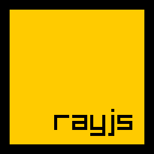
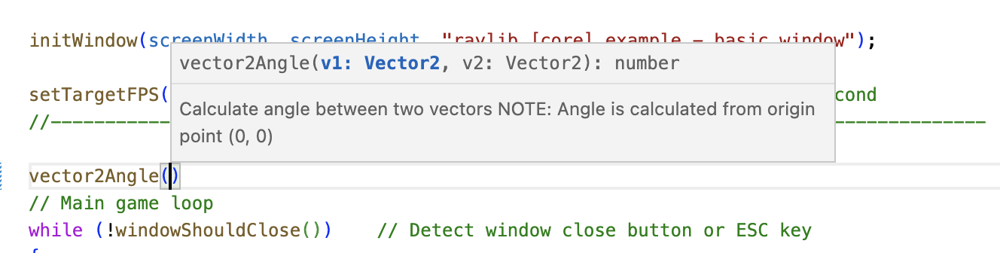
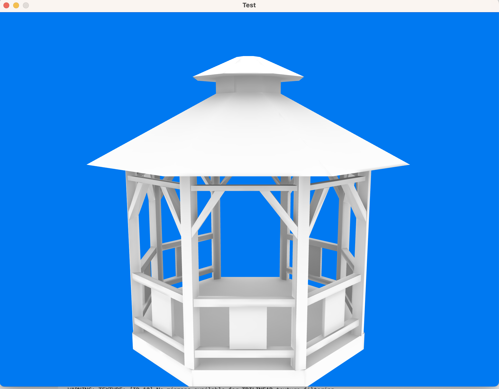
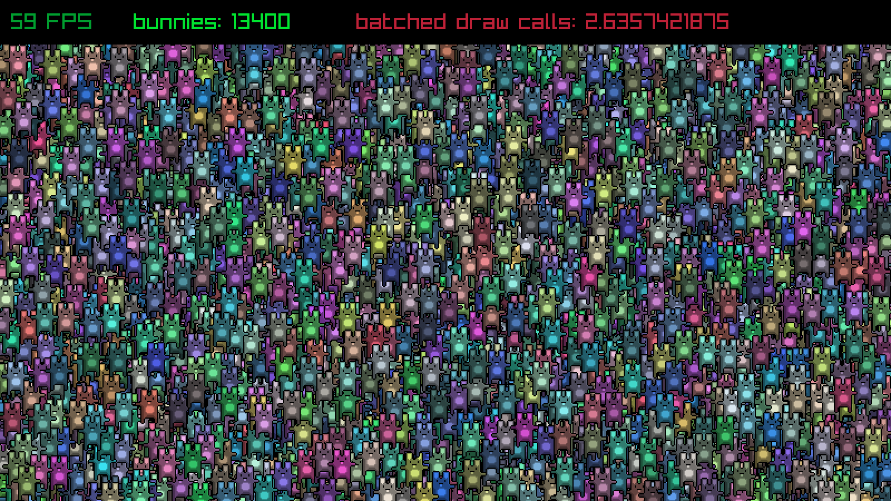

# rayjs - JavaScript + Raylib

QuickJS based JavaScript bindings for raylib **5.5** in a single ~3MB executable.

## What is this?

rayjs is a small ES2020 compliant JavaScript interpreter based on [QuickJS](https://bellard.org/quickjs/) with bindings for [Raylib](https://www.raylib.com/) (version **5.5**). You can use it to develop desktop games with JavaScript.

## What this is not

rayjs is not a binding for NodeJS nor is it running in the browser (yet). It comes with its own JavaScript engine (QuickJS) similar to how NodeJS comes with the V8 engine. That makes it much easier to run and distribute rayjs programs — all you need is the small rayjs executable. No installation, no DLLs or additional files required.

## Features

* Compiles into a single, small executable without any dependencies for easy distribution
* Use modern JavaScript features like classes and async/await
* Full auto-complete with TypeScript definitions for the entire raylib 5.5 API
* Built on raylib 5.5 (stable), raygui 4.0

## Getting started

1. Download the binary for your platform from the [release section](https://github.com/mode777/rayjs/releases).
2. Unzip the executable to a folder and create a new text file in the same folder. Rename the file to `main.js`
3. Open the file with a text editor (e.g. Notepad) and add the following code:
    ```javascript
    const screenWidth = 800;
    const screenHeight = 450;

    initWindow(screenWidth, screenHeight, "raylib [core] example - basic window");

    setTargetFPS(60);   
    while (!windowShouldClose()) {
        beginDrawing();

            clearBackground(RAYWHITE);

            drawText("Congrats! You created your first window!", 190, 200, 20, LIGHTGRAY);

        endDrawing();
    }
    closeWindow();
    ```
4. Run the `rayjs` executable
5. Congratulations, you have created your first rayjs app!

## Running code

rayjs will run code in three different modes:

1. If no parameter is given it will look for a file called `main.js` in the executable directory
2. It will run a given JavaScript file passed as a command line argument: `rayjs <filename>`
3. It will look for a file called `main.js` in a folder given as a command line argument: `rayjs <foldername>`

The directory of the main JavaScript module will also be the working directory of the app. Modules and resources will be loaded relative to it.

## API support

The following raylib 5.5 APIs are supported (with a few exceptions noted in `CHANGELOG_5.5.md`):

- core (no VR support yet)
- shapes
- textures
- text (no support for GlyphInfo yet)
- models (no animation support yet)
- shaders
- audio
- raymath
- rcamera
- rlights
- raygui
- reasings

**718 functions bound** (105 intentionally ignored due to unsupported pointer types).

All types and functions are provided globally for convenience. They are additionally available as a module called `'raylib'`.

To check which API functions are not available, see `MIGRATION_TABLE.md` or the `ignore()` statements in `bindings/src/index.ts`.

## Additional APIs

rayjs comes with some additional functionality on top of raylib to make writing code with JavaScript easier:

```typescript
/** Replace material in slot materialIndex (Material is NOT unloaded) */
declare function setModelMaterial(model: Model, materialIndex: number, material: Material): void;
/** Get material in slot materialIndex */
declare function getModelMaterial(model: Model, materialIndex: number): Material;
/** Get a single mesh from a model */
declare function getModelMesh(model: Model, meshIndex: number): Mesh;
/** Set shader constant in shader locations array */
declare function setShaderLocation(shader: Shader, constant: number, location: number): void;
/** Read a single pixel from an image */
declare function imageReadPixel(image: Image, x: number, y: number): Color;
/** Make a deep-copy of an existing mesh */
declare function meshCopy(mesh: Mesh): Mesh;
/** Create a new mesh that contains combined attributes of two meshes */
declare function meshMerge(a: Mesh, b: Mesh): Mesh;
```

Additionally it comes with bindings to [lightmapper.h](https://github.com/ands/lightmapper/tree/master).

## Auto-Complete / Intellisense

rayjs comes with full auto-complete support via the definitions file `lib.raylib.d.ts`. These work with TypeScript and JavaScript projects. To use with JavaScript, create a `tsconfig.json` in your project root:

```json
{
  "compilerOptions": {
    "allowJs": true,
    "target": "es2020",
    "lib": ["ES2020"]
  }
}
```

Place `lib.raylib.d.ts` in the same folder and restart your IDE. Auto-complete should work:



## Examples

Ported raylib examples can be found in the `examples` folder.

```bash
./rayjs examples/js_example_project
```
Barebones example project showing how to structure a JavaScript project.

```bash
./rayjs examples/textures/bunnymark.js
```
Classic bunnymark performance test.

```bash
./rayjs examples/textures/bunnymark_opt.js
```
Optimized bunnymark using Float32Array (higher performance, no GC pressure).

```bash
./rayjs examples/shaders/js_shaders_gradient_lighting.js
```
Creates a gradient and uses it as lighting for a 3D scene.

```bash
./rayjs examples/ts_dungeon
```
Small example game using TypeScript with Webpack.

```bash
./rayjs examples/ts_game
```
Example integrating existing JS libraries (Inkjs interactive fiction).

### Lightmapper usage

rayjs integrates the [lightmapper.h](https://github.com/ands/lightmapper/tree/master) library for baked lighting:

```bash
./rayjs examples/js_lightmapper.js
```

Meshes must have unwrapped lightmap UVs in the second UV channel.



## Performance

QuickJS is one of the [faster JS interpreters](https://bellard.org/quickjs/bench.html). The optimized bunnymark (`bunnymark_opt.js`) uses Float32Array for buffer-based object storage, significantly reducing GC pressure and improving frame rates.



## Building from source

### Prerequisites

- CMake
- C compiler (GCC, Clang, MSVC)
- Git

### Build steps

```bash
git clone https://github.com/mode777/rayjs.git
git submodule update --init --recursive
cd rayjs
mkdir build
cd build
cmake ..
make
```

The executable will be placed in the project root directory.

## Migration from raylib 4.5

See `CHANGELOG_5.5.md` for a detailed changelog of all changes made during the migration from raylib 4.5 to 5.5.

See `MIGRATION_TABLE.md` for a function-by-function comparison.